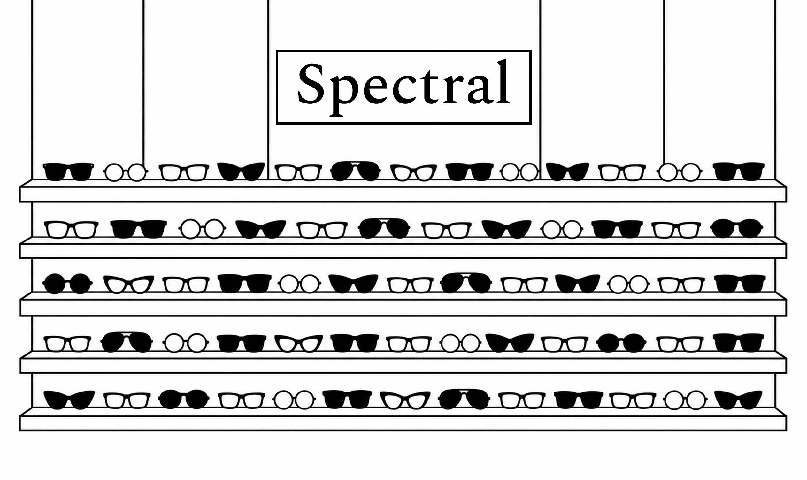

## Spectral
### Spectral — специмен шрифта

Одностраничный сайт о шрифте Spectral в стилистике оптики и проверки зрения. Учебный проект, 2026.

### Сайт
https://mvp991.github.io/spectral-masha/

### Скриншот

### Автор
Мария Плошихина, группа Б26ДЗ10

### О проекте

Сайт рассказывает о шрифте Spectral: его начертаниях, особенностях, истории создания и поддерживаемых языках. Визуальная идея основана на эстетике оптики: шрифт представлен через очки, линзы, таблицы проверки зрения и рецепт на очки.

### Как сделано

Дизайн разработан мной в Figma. Вёрстка выполнена на HTML и CSS. Используется шрифт Spectral в разных начертаниях. Графические элементы подготовлены в форматах SVG и PNG.

### Использование ИИ

При создании сайта использовался ИИ-ассистент ChatGPT (OpenAI). Я самостоятельно разработала дизайн, подготовила графические материалы и определила структуру сайта. ИИ помогал с написанием HTML и CSS, переносом макета в код, исправлением ошибок и настройкой расположения элементов. Я ставила задачи, проверяла результат и вносила корректировки. Уровень помощи ИИ: 2-3.

### Использование ИИ

При создании сайта использовался ChatGPT (OpenAI). Дизайн, композиция и графические материалы разработаны мной в Figma. ИИ помогал переносить макет в HTML и CSS, писать код отдельных блоков, подключать изображения и начертания шрифта, а также исправлять ошибки вёрстки. Я задавала требования, проверяла результат и вносила корректировки.

| Инструмент | Для чего использовался | Уровень |
|---|---|---|
| ChatGPT | Объяснение ошибок в CSS, исправление отступов и расположения элементов | 2 |
| ChatGPT | Создание и корректировка кода блока с начертаниями шрифта. Запись №1 в README | 3 |
| ChatGPT | Написание CSS для переходов между секциями и размещения графических элементов. Запись №2 в README | 3 |

#### Запись №1 

- **Что я хотел(а) сделать:** [ Отобразить правильно блок с начертаниями]
- **Что я спросил(а):** [ Как это сделать]
- **Что ответил ИИ:** [Прислал код ]
- **Что я изменил(а) сам(а):** [ Заменила размер]
- **Как я понял(а), что это работает:** [Проверила в браузере ]

#### Запись №2

- **Что я хотел(а) сделать:** [Плавный переход между черным и белым ]
- **Что я спросил(а):** [ Как правильно вставить файл svg]
- **Что ответил ИИ:** [ Прислал код]
- **Что я изменил(а) сам(а):** [ Изменила позицию]
- **Как я понял(а), что это работает:** [Проверила в браузере 

#### Заметки
Честно, я не очень поняла по записи 2. На сайте видно эти стыки, я не знаю, как их исправить.
